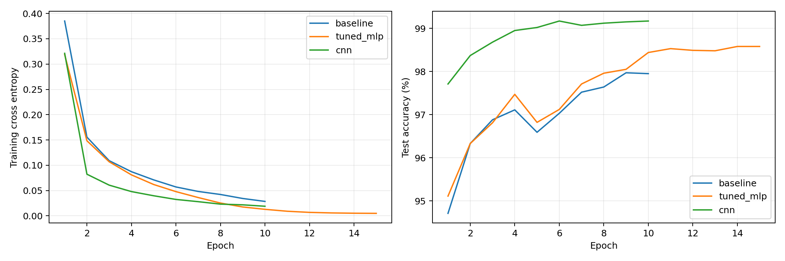
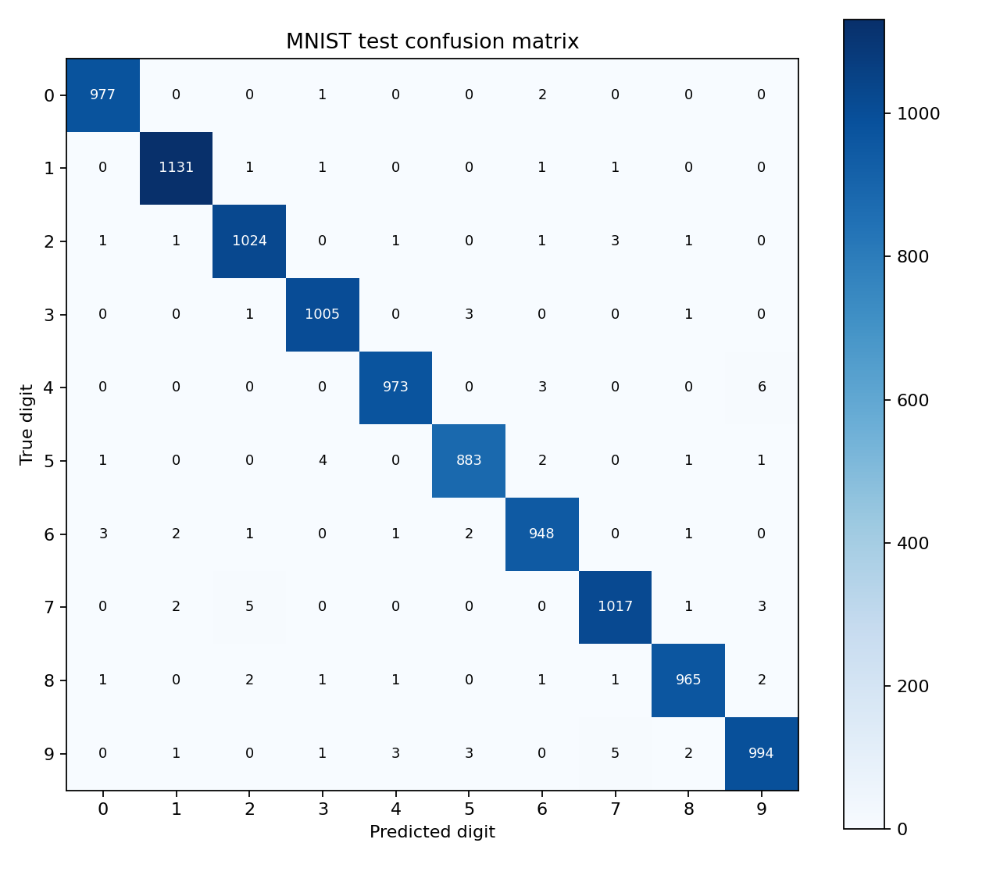
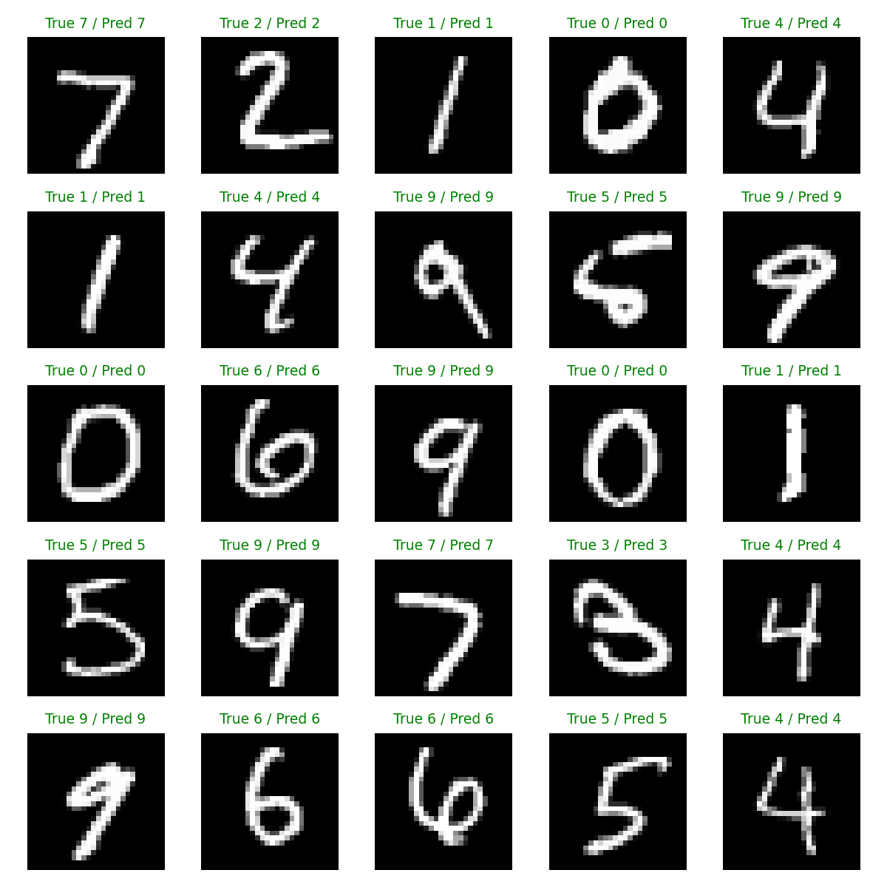
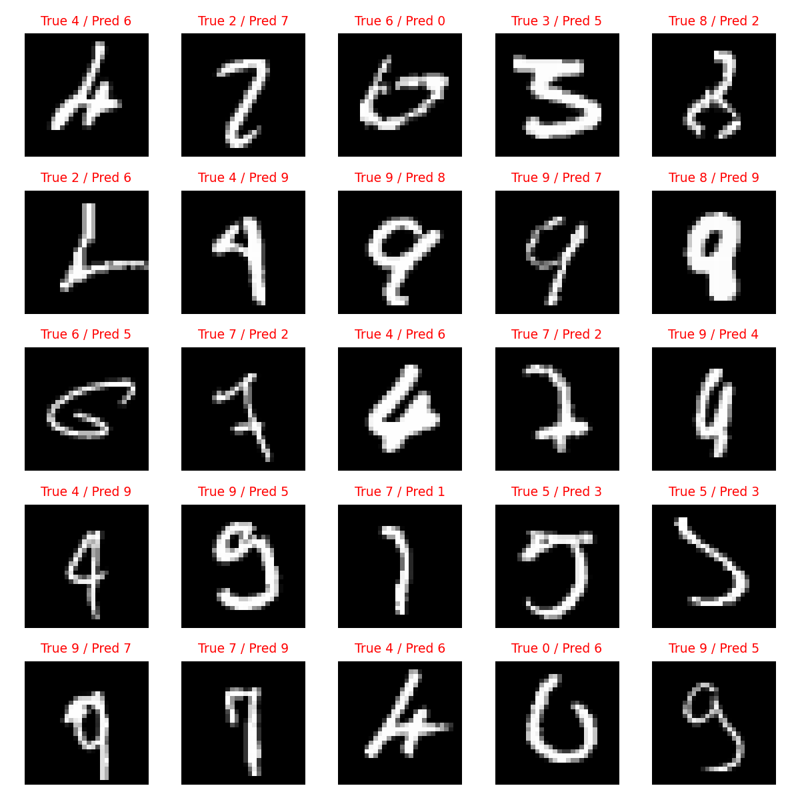

# 实验四 PyTorch 神经网络手写数字识别

## 实验目的和实际环境

使用 PyTorch 实现 MNIST 手写数字分类，完成数据加载、网络构建、训练、测试以及参数和结构改进。运行于 Windows 的 conda 环境 `Unmanned_systems`，全程使用 CPU 和 4 个计算线程。文档建议 WSL Ubuntu 22.04，本次按现有系统采用 Windows 原生 conda；环境详情见 `results/environment.json`。

采用完整 MNIST 训练集 60000 张和测试集 10000 张，图像为 28×28 单通道灰度图。默认下载源连接失败后，通过 Google 托管的公开 MNIST 镜像下载，逐个使用 torchvision 内置 MD5 校验。下载及校验程序为 `download_mnist.py`。

## 主要功能单元原理和应用方法

1. 数据加载：`datasets.MNIST` 读取图像和标签；`ToTensor` 将像素转换到 [0,1]，`Normalize((0.5,), (0.5,))` 将其变为 [-1,1]。`DataLoader` 按批次迭代，训练集随机打乱，测试集保持顺序。
2. 全连接网络：`Net` 将图像展平为 784 维，经过 512、256 个隐藏单元后输出 10 个 logits。每个线性层执行 Wx+b，隐藏层的 ReLU 引入非线性，以学习复杂分类边界。该结构与文档示例一致。
3. 损失函数：`CrossEntropyLoss` 将 log-softmax 和负对数似然合并，直接接收 logits 与整数标签；训练时无需先调用 softmax。
4. 优化与反向传播：每批调用 `zero_grad` 清除旧梯度，前向传播计算损失，`backward` 按链式法则求导，`step` 更新参数。基准 SGD 的学习率为 0.01，动量为 0.9。
5. 测试：`eval()` 关闭训练阶段特有行为，`inference_mode()` 关闭梯度跟踪；取 10 个 logits 的最大值对应类别，准确率为预测正确数/样本总数。损失按样本数加权平均。
6. 保存与识别：`model.pt` 保存权重、网络配置与预处理参数；`predict.py` 重建网络后加载权重，复用相同归一化。所有三组权重均已重新加载，在 10000 张测试图像上重新推理，结果逐项与保存的预测文件一致，见 `results/verification.json`。

## 实验设置

| 方案 | 网络结构 | 训练参数 |
| --- | --- | --- |
| baseline | 784→512→256→10，ReLU | SGD，lr=0.01，momentum=0.9，batch=64，10 轮 |
| tuned_mlp | 与 baseline 完全相同 | SGD，初始 lr=0.03，momentum=0.9，weight_decay=0.0001，余弦学习率衰减，batch=64，15 轮 |
| cnn | Conv(1→16,3×3)→ReLU→Pool→Conv(16→32,3×3)→ReLU→Pool→FC(1568→128)→ReLU→Dropout(0.25)→FC(128→10) | Adam，初始 lr=0.001，weight_decay=0.0001，余弦学习率衰减，batch=128，10 轮 |

三组固定随机种子 42，均使用全部训练样本。每轮记录测试曲线，但不按测试结果挑选权重，结果统一采用预先指定训练轮数的最后一轮。

## 实际运行结果

| 方案 | 轮数 | 参数量 | 测试准确率 | 测试损失 | 训练及逐轮评估耗时（秒） |
| --- | --- | --- | --- | --- | --- |
| baseline | 10 | 535,818 | 97.95% | 0.06669 | 70.8 |
| tuned_mlp | 15 | 535,818 | 98.58% | 0.05290 | 105.7 |
| cnn | 10 | 206,922 | 99.17% | 0.02481 | 122.5 |



## 问题 4.2.1 保持结构并调整参数

在不改变全连接层数、宽度及激活函数的情况下，提高初始学习率、采用余弦学习率衰减、加入轻微权重衰减并延长训练。较大的初始学习率有助于前期优化，后期逐步降低学习率有助于细化权重；权重衰减抑制过大的权重，较多轮次提供更多优化机会。

基准准确率为 97.95%，调参后为 98.58%，差值为 +0.63 个百分点。该结果是上述训练参数组合在本次固定种子运行中的总体效果，不代表某个单独参数的因果贡献。

## 问题 4.2.2 修改网络结构

卷积网络保留二维图像的空间邻接关系，通过局部感受野提取笔画和边缘；参数共享使同一滤波器在不同位置检测相同模式。池化降低空间分辨率及计算量，并为小幅位置变化提供一定鲁棒性。两层卷积组合形成更复杂的局部特征，再通过全连接层分类；Dropout 在训练时随机屏蔽部分隐藏单元，有助于缓解过拟合。

CNN 的测试准确率为 99.17%，相对原始全连接基准变化 +1.22 个百分点，相对调参后的全连接网络变化 +0.59 个百分点。参数量由基准的 535,818 变为 206,922。由于卷积需要在多个空间位置计算，参数更少并不必然意味着 CPU 训练更快。







## 结果解释与局限

混淆矩阵的行是真实数字，列是预测数字，对角线为正确分类数量。`errors.png` 按测试集顺序展示最多 25 个误分类样本，可用于观察模糊笔画和相似数字；不是手工筛选出的最差或最好样本。每个模型完整的 10000 条预测保存在 `test_predictions.csv`。

本实验是单种子比较，未进行显著性检验；CNN 的优化器、批大小和结构同时变化，因此展示的是整体改进方案，不是严格的单变量结构消融。若要独立验证卷积结构的贡献，需要统一训练参数与计算预算。后续超参数搜索应先从训练集划分验证集，最终只在独立测试集上评估一次，并通过多种子实验报告均值和标准差。

## 复现

在 Anaconda Prompt 中运行：

```bat
conda activate Unmanned_systems
cd /d D:\Desktop\无人系统\exp2
python mnist_experiment.py
python verify_results.py
python predict.py --index 0
```

`README.md` 给出 DLL 启动问题的替代命令及环境安装方法。所有准确率均来自本次真实运行，详细配置、逐轮指标和日志保存在 `results`。
